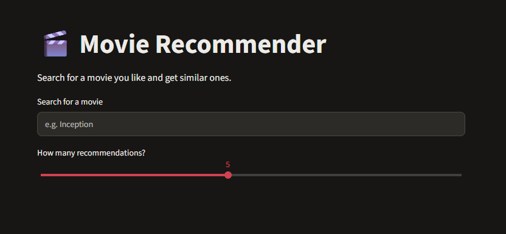

# 🎬 Movie Recommender System

A movie recommender built in two phases: a **traditional content-based model** (finished, with a working web app) and an **LLM-based version** (next), so the two approaches can be compared on the same data.

Search for a movie, pick the exact title, and get similar movies ranked by genres, top cast, director and plot text.

<!-- Add a screenshot of the Streamlit app here:  --> 

## 🌐 Live demo

- **App:** https://movierecommendersystem-n4gcknzbc7zxtfrrzprvyd.streamlit.app/
- **API docs (Swagger UI):** https://movie-recommender-system-qnvy.onrender.com/docs

> The API runs on a free Render tier, so it goes to sleep when idle. The first search after a break can take up to a minute while it wakes up. If the app shows a "waking up" message, wait a few seconds and try again.

---

## 📖 How this project grew

This project is more than one build. It started as a way to learn pandas and became a full system.

| When | What happened |
|---|---|
| **April 2026** | Started the project to **learn how pandas works**. I followed GitHub repos and YouTube tutorials, cleaned and analysed Kaggle's *The Movies Dataset* (movies metadata + credits), and practised merging, parsing and cleaning real messy data. That work lives in `notebook/cleaning-movies-analysis.ipynb`. |
| **October–November 2026** | Came back to it and **rebuilt everything from scratch**, this time as a real recommender: a much larger and newer dataset, fresh cleaning pipeline, a new feature design, a FastAPI backend and a Streamlit front end. |

### Two phases

- **Phase 1: Traditional model.** Content-based recommender using TF-IDF, token counts and cosine similarity. *Done. This is what this repo currently contains.*
- **Phase 2: LLM-based recommender.** A second version that uses a language model, to compare against the traditional baseline on quality and behaviour. *Planned.*

---

## ✨ Features

- Recommends similar movies from **100,000+ titles**
- Search with a dropdown to pick the exact movie (handles titles shared by several movies, like remakes)
- Shows year, genres, director, rating, vote count and a match score
- Typo handling: an unknown title returns "did you mean" suggestions from the API
- REST API (FastAPI) that can be used on its own, plus a Streamlit app on top of it

---

## 🧠 How the recommender works

1. **Clean the data.** Merge movie metadata with cast and director credits using pandas.
2. **Build a "metadata soup" per movie.** Genres, the top 3 billed actors and the director become single tokens (`Tom Hanks` becomes `tomhanks`), so `Tom` doesn't partly match `Tom Cruise`.
3. **Vectorize two ways.**
   - Metadata: `CountVectorizer`, because genres, actors and directors are exact labels.
   - Plot (overview + tagline): `TfidfVectorizer`, because rare words carry the meaning in free text.
4. **Blend the two** with weights (metadata 0.6, plot 0.4) into one sparse matrix, one row per movie.
5. **Rank by cosine similarity** between the chosen movie and every other movie. Similarity is computed one movie at a time, so a full 100k × 100k matrix is never built.
6. **Re-rank for popularity.** Among the 100 closest movies, the score is `similarity × (1 + 0.25 × log10(votes))`. This stops obscure shorts with similar metadata from beating well-known films.

The trained artifacts (movie table + feature matrix) are saved with `joblib`, so the API loads them at start-up instead of recomputing.

---

## 🏗️ Architecture

```
Streamlit app  ──HTTPS──►  FastAPI  ──►  recommender_artifacts.joblib
 (streamlit_app.py)         (app.py)      (movie table + feature matrix)
 Streamlit Community Cloud  Render
```

| Endpoint | Purpose |
|---|---|
| `GET /` | Status and number of movies loaded |
| `GET /search?q=...` | Titles containing the text, most-voted first |
| `POST /recommend` | Body: `{"title": "...", "year": 2010, "n": 10}`. Returns the matched movie and a ranked list. `year` is optional; `n` is 1 to 30 |

Interactive API docs are available at `/docs` when the server runs.

---

## 🛠️ Tech stack

Python · pandas · NumPy · scikit-learn · SciPy · joblib · FastAPI · Uvicorn · Pydantic · Streamlit · Requests

---

## 📂 Project structure

```
Movies_Recommender_System/
├── app.py                         # FastAPI backend
├── streamlit_app.py               # Streamlit front end
├── requirements.txt
├── README.md
├── notebook/
│   ├── cleaning-movies-analysis.ipynb               # April: first pandas project
│   ├── cleaning_data_for_recommender_system.ipynb   # Oct–Nov: cleaning for the recommender
│   └── Recommender_system.ipynb                     # Oct–Nov: features, similarity, saving the model
└── traditional_model/
    └── recommender_artifacts.joblib                 # saved model used by the API
```

The raw datasets (`data/`) are large and not stored in this repo.

---

## 🗂️ Data

- **Movies:** *Full TMDB Movies Dataset* (Kaggle, by asaniczka), about 1 million movies. After removing duplicate ids and keeping movies with at least 5 votes, **103,205 movies** are used.
- **Cast and director:** *Popular 10,000 Movies Listed on TMDb* (Kaggle, by manashjyotiborah), plus credits fetched from the TMDB API for the 40,000 most-voted movies that were still missing them.
- **First version (April):** Kaggle's *The Movies Dataset* (movies metadata + credits).

---

## 🚀 Run it locally

```powershell
git clone https://github.com/AmeyDande/Movie_recommender_system.git
cd Movie_recommender_system
python -m venv .venv
.venv\Scripts\Activate.ps1
python -m pip install -r requirements.txt
```

Start the API (first terminal):

```powershell
python -m uvicorn app:app --reload
```

Start the app (second terminal, same folder, venv active):

```powershell
python -m streamlit run streamlit_app.py
```

Open `http://localhost:8501`. The API runs at `http://127.0.0.1:8000` (docs at `/docs`).

Using the API directly:

```python
import requests

r = requests.post('http://127.0.0.1:8000/recommend',
                  json={'title': 'Inception', 'year': 2010, 'n': 5})
print(r.json())
```

### Rebuild the model from scratch

1. Download the datasets above into a `data/` folder.
2. Run `cleaning_data_for_recommender_system.ipynb`. It saves a cleaned movies CSV.
3. Run `Recommender_system.ipynb`. It builds the features and saves `recommender_artifacts.joblib` into `traditional_model/`.

---

## ☁️ Deployment

The API and the app are deployed separately, and the app finds the API through an `API_URL` setting (it defaults to `http://127.0.0.1:8000` for local use).

- **API on Render** (Web Service): build command `pip install -r requirements.txt`, start command `uvicorn app:app --host 0.0.0.0 --port $PORT`. The saved model is committed to the repo, so the API needs no raw data.
- **App on Streamlit Community Cloud:** main file `streamlit_app.py`, with a secret pointing at the API:

```toml
API_URL = "https://movie-recommender-system-qnvy.onrender.com"
```

---

## ⚠️ Known limitations

- **Cast and director are only available for the most-voted movies.** Obscure movies are matched mainly on genres and plot, so their recommendations are weaker.
- **Movies with fewer than 5 votes are excluded**, and movies newer than the dataset snapshot may be missing.
- **Content-based only.** It knows nothing about user taste or ratings, so it can't say "people who liked this also liked...".
- **Search matches exact letters**, so "end game" won't find "Endgame".

---

## 💡 What I learned

- **Data quality decides recommendation quality.** Several silent problems were hurting results: genres joined with `-` but split on `|`, cast stored as `actor as character` but read as `character as actor`, and truncated crew records that made directors disappear. None of them raised an error.
- **Different kinds of text need different vectorizers.** Exact labels (names, genres) suit counts; free text suits TF-IDF.
- **A ranking signal can fix what similarity alone can't.** A small popularity re-rank made the results far more sensible.
- **Rebuilding a project teaches more than finishing it once.** Redoing it from scratch, with six more months of experience than April, changed almost every design decision.

---

## 🔭 What's next

- Phase 2: an LLM-based recommender and a side-by-side comparison with this model
- Smarter search (ignore spaces and punctuation)

---

## 🙏 Credits

- Movie data from [TMDB](https://www.themoviedb.org/) via Kaggle datasets and the TMDB API.
- Learned pandas from GitHub projects and YouTube tutorials.

*This product uses the TMDB API but is not endorsed or certified by TMDB.*

This is a personal, non-commercial portfolio project.